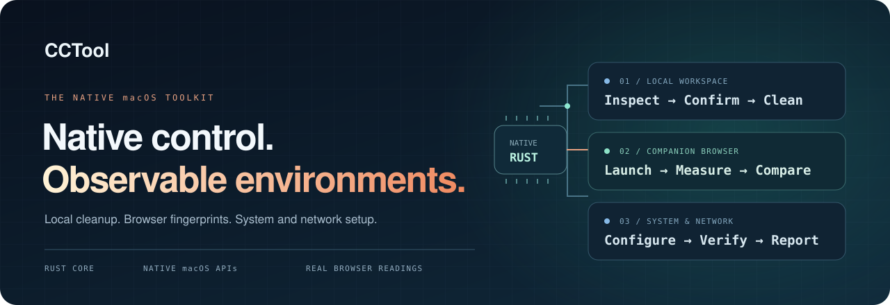
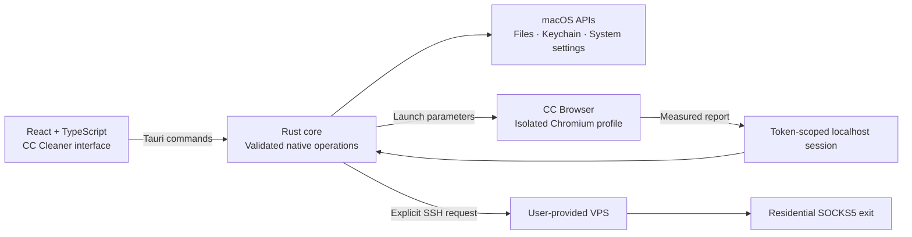

<!--
[INPUT]: 已实现功能、构建配置、双应用发布契约与 MIT/第三方许可边界。
[OUTPUT]: 面向公开仓库的英文产品首页、安装与开发入口、架构和贡献导航。
[POS]: 项目公开入口；不承载内部迁移历史、本机账户路径或签名凭据。
[PROTOCOL]: 变更时更新此头部，然后检查 CLAUDE.md
-->
<div align="center">
  
  <h1>CCTool</h1>
  <p><strong>A native macOS toolkit for a cleaner workspace and an environment you can verify.</strong></p>
  <p>Claude cleanup · Browser fingerprints · System settings · Network setup</p>
  <p>
    <a href="LICENSE"></a>
    
    
    
  </p>
  <p>
    <a href="#features">Features</a> ·
    <a href="#installation">Installation</a> ·
    <a href="#quick-start">Quick start</a> ·
    <a href="#architecture">Architecture</a> ·
    <a href="#development">Development</a> ·
    <a href="CONTRIBUTING.md">Contributing</a>
  </p>
</div>



CCTool brings local maintenance and environment setup into one focused desktop workflow. Inspect Claude data before removing it, rotate your companion browser's fingerprint and restart it, align system settings with a selected region, and compare real browser readings with the machine and network exit.

Two applications work together: **CC Cleaner** owns native operations; **CC Browser** runs an isolated Fingerprint Chromium profile. Browser measurements return to the cleaner through a local session. Changing a setting and verifying its effect are separate steps.

## Features

<table>
  <tr>
    <td width="33%"><strong>Local Claude cleanup</strong><br /><br />Review caches, account traces, sessions, configuration remnants and existing backups. Select exactly what to remove.</td>
    <td width="33%"><strong>Fingerprint &amp; restart</strong><br /><br />Generate a fresh seed, apply the selected region's language and timezone, then restart the companion browser.</td>
    <td width="33%"><strong>Real environment checks</strong><br /><br />Compare browser and machine readings with the actual network exit. Passing measured checks produces a green page and a large checkmark.</td>
  </tr>
  <tr>
    <td><strong>Native system settings</strong><br /><br />Apply timezone, preferred language and region settings. Open macOS controls for location and permissions.</td>
    <td><strong>SSH network setup</strong><br /><br />Provide a VPS address, three key files and a residential SOCKS5 exit. Receive a subscription after server self-checks pass.</td>
    <td><strong>Claude Code CLI tools</strong><br /><br />Detect the installation method and version. Uninstall or reinstall through native, npm or Homebrew workflows.</td>
  </tr>
</table>

**One region selector. Four everyday actions.** Easy setup puts browser cache cleanup, fingerprint rotation, timezone/language reset and Claude cleanup on the same page. The sidebar keeps advanced controls in Network, Claude cleanup, Browser and Computer.

The interface supports **English and Chinese**, with shared YAML catalogs. Switching the interface language does not change the computer or browser language.

## Installation

**Platform:** macOS 12 or later, Apple Silicon. Intel, Windows and Linux application builds are not currently supported.

Download the signed installer from [GitHub Releases](https://github.com/liseami/CCFUCKER/releases/latest). The distribution package is named `CCTool-<version>-macos-arm64.dmg`. It contains both applications:

| Application | Installed bundle | Role |
| --- | --- | --- |
| CC Cleaner | `CC清理器.app` | Cleanup, system settings, SSH tasks and verification |
| CC Browser | `CC浏览器.app` | Companion browser with a dedicated profile |

1. Open the release disk image and drag **both applications** into Applications.
2. Launch CC Cleaner. It starts the companion browser automatically.
3. Choose English at the bottom of the sidebar if needed.

Public release packages must pass Developer ID signing, Apple notarization, ticket stapling and Gatekeeper assessment. See the [release procedure](docs/releasing.md) for the exact checks. macOS may still display its normal first-launch confirmation and ask for permissions when you use privileged features.

Source builds are available through the [development guide](#development). Every successful push to `release` produces a new version, tag and notarized installer.

## Quick start

### Everyday setup

Open **Easy setup**, select a country or region, then choose an action. Browser fingerprint rotation closes and restarts CC Browser, so save unfinished browser work first. Selecting a region changes language, timezone and regional settings; it does **not** change your public IP.

### Claude cleanup

Open **Claude cleanup** to scan and review local data. Use cache-only cleanup for regenerable files, login reset for account traces, or select a broader scope explicitly. A folder can also be dropped into the app for a scoped scan.

If Claude is running, the confirmation flow can stop all recognized Claude processes and rescan. The latest scan must be reviewed before deletion. CLI uninstall and reinstall are separate operations and preserve settings, skills, sessions and project files.

> [!WARNING]
> Confirmed cleanup permanently deletes the selected files, including selected existing backups. It does not use Trash, create recovery copies or provide undo. Stopping Claude processes can interrupt unsaved work.

### Browser verification

Open **Browser** or the companion browser's local test page to measure the actual environment. Checks cover the network exit, country, timezone, language, platform, CPU count, engine version and location settings.

The success page appears only when the measured checks match, the report reaches the cleaner and no measurement error remains. **DNS and WebRTC leak checks are not independently verified.** A green result describes the measured checks, not a guarantee of anonymity or account acceptance.

### Network setup

The optional network workflow expects:

| Input | Requirement |
| --- | --- |
| VPS | Public IP or hostname; Debian 12/13; SSH as `root` on port `22` |
| SSH keys | A matching `.pem`, `.ppk` and `.pub` bundle; an unencrypted PEM private key |
| Residential exit | SOCKS5 host, port, username and password |
| Expected exit IP | Required when the SOCKS5 host is a domain |

For DMIT, choose **Generate SSH Key after order**, download and extract the key bundle, then select or drop all three files. Key files identify you; the VPS address identifies the server. Password and SSH Agent authentication are not supported.

Check the SSH connection, review the server changes, then run setup. The script updates the Debian system, configures Xray/Reality, SSH and the firewall, and verifies the SOCKS5 exit before returning a subscription. It blocks forwarded UDP and retains a Stripe direct-route exception.

> [!IMPORTANT]
> Import the subscription into a compatible client, enable **TUN mode**, and leave **system proxy disabled**. Leave CC Browser's explicit proxy empty to follow TUN. The subscription uses HTTP and contains connection credentials; keep its URL private. Verify the client-side exit after importing it.

Provider buttons link to [DMIT](https://www.dmit.io/aff.php?aff=28800) and [Webshare](https://www.webshare.io/?referral_code=qlm1mt9xibc9). These URLs contain affiliate/referral codes. Network setup is optional; local cleanup does not require a VPS or a proxy subscription.

## Architecture



The UI owns inputs and presentation. Rust owns validation, task locks, process identity checks and execution. Small Objective-C bridges call platform APIs. The browser test page has no Tauri command access; it exchanges context and measurements through a random-token loopback session.

| Layer | Technology | Responsibility |
| --- | --- | --- |
| Desktop host | Rust · Tauri 2 | Native commands, transactions, progress and lifecycle |
| Interface | React 19 · TypeScript · Cromma UI | Forms, previews and execution results |
| Platform bridges | AppKit · Security · CoreLocation | macOS permissions and system integration |
| Companion browser | Fingerprint Chromium | Dedicated profile and real browser measurements |
| Network setup | OpenSSH · Bash · Xray | Explicit remote setup and server self-checks |
| Localization | YAML · Vite | Build-time English/Chinese catalogs |

<details>
<summary><strong>Repository map</strong></summary>

```text
assets/             Compressed source logos shared by icons and README
src/                Desktop UI, browser test page and localization
src-tauri/src/      Rust commands and transaction boundaries
src-tauri/native/   Small macOS API bridges
browser-runtime/    Engine metadata, launcher, entitlements and licenses
scripts/            Icons, signing, packaging and setup scripts
docs/               README artwork and release procedure
vendor/cromma-ui/   Vendored interface components
```

The large browser application and archive are generated/runtime inputs, excluded from Git. `CLAUDE.md` files map module boundaries; source headers describe inputs, outputs and responsibilities.

</details>

## Development

### Prerequisites

Use an Apple Silicon Mac with Xcode Command Line Tools, stable Rust and Bun. Follow [Tauri's macOS prerequisites](https://v2.tauri.app/start/prerequisites/#macos) for the native toolchain.

The browser engine is an external build input. `python3 scripts/fetch-browser.py` downloads the pinned macOS arm64 **Fingerprint Chromium 148.0.7778.215** engine from the [upstream project](https://github.com/adryfish/fingerprint-chromium), verifies its SHA-256 and preserves its bundle structure and notices. Browser runtime binaries are not included in the source repository.

From your checkout:

```sh
bun install --frozen-lockfile
python3 scripts/fetch-browser.py
sh scripts/make-icons.sh
sh scripts/package-browser.sh
bun run tauri dev
```

Local builds use ad-hoc signing by default, so another developer does not need the maintainer's certificate. They are not public distribution builds. See [Tauri's signing documentation](https://v2.tauri.app/distribute/sign/macos/) and the [release procedure](docs/releasing.md) for Developer ID signing and notarization.

### Automated releases

Push to `release` to run the complete macOS pipeline: frontend and native tests, pinned engine verification, Developer ID signing, Apple notarization and offline ticket stapling. A successful run creates an increasing `v<major>.<minor>.<patch>` tag and uploads the DMG and SHA-256 manifest. Public repositories also receive GitHub build provenance attestations. Apple credentials stay in GitHub Secrets and a disposable runner keychain. See [release setup](docs/releasing.md#github-actions).

### Build

```sh
MACOSX_DEPLOYMENT_TARGET=12.0 \
  bun run tauri build --bundles app --features custom-protocol
```

The cleaner bundle is written to `src-tauri/target/release/bundle/macos/CC清理器.app`. The companion bundle remains at `browser-runtime/Browser.app` until copied to Applications as `CC浏览器.app`.

Release builds require `custom-protocol` to load the embedded UI. A release compilation without it fails explicitly, preventing an installed app from depending on the development server.

### Checks

```sh
bun run build
bun test
MACOSX_DEPLOYMENT_TARGET=12.0 \
  cargo test --manifest-path src-tauri/Cargo.toml
python3 scripts/test-sign-browser.py
bash -n scripts/setup-vps.sh
```

Automated tests exercise disposable fixtures and local test servers. They do not deploy a real VPS, delete your Claude account data or perform administrator-authorized system changes. Real SSH connectivity, client-side TUN routing and permission-dependent operations require validation in the target environment.

## Data & permissions

- **Cleanup is local.** It targets recognized Claude data; project source, skills, plugins, hooks, commands and MCP settings are preserved. Cloud-side account records are outside its scope.
- **Secrets stay out of UI logs.** SSH private-key contents remain in native code. A temporary PEM copy has `0600` permissions and is removed when the transaction ends. Keychain cleanup reads item attributes, not password contents.
- **Network checks make real requests.** Exit detection uses `ipwho.is` with `ipapi.co` as a fallback on the same route. IP location is a service estimate.
- **Remote changes are explicit.** Only the VPS you provide is contacted for SSH setup. Server credentials remain in the server configuration required to run its services.
- **Permissions are feature-specific.** Timezone changes require macOS administrator authorization. Keychain access follows system prompts. Location controls may require Accessibility permission or a manual action in System Settings.

Custom `CLAUDE_CONFIG_DIR` locations are not automatically included in the default cleanup scan. The app reports this limitation rather than silently claiming they were cleaned.

## Contributing

Start with [CONTRIBUTING.md](CONTRIBUTING.md). Small, focused changes with clear behavior and relevant checks are welcome. For bug reports, include the macOS version, app version, operation and sanitized error; never attach private keys, passwords or subscription URLs.

## License & credits

CCTool's original project code is released under the **[MIT License](LICENSE)**. Third-party code and binaries retain their own terms; see [NOTICE.md](NOTICE.md).

Built with [Tauri](https://tauri.app/), [React](https://react.dev/) and [Fingerprint Chromium](https://github.com/adryfish/fingerprint-chromium), with a native macOS implementation of Claude maintenance workflows. Cleanup discovery was informed by the [claude-cleanup skill](https://github.com/suyuan2022/suyuan-skill/tree/main/claude-cleanup).

<div align="center">
  <sub>An independent project. Not affiliated with or endorsed by Anthropic or Apple.</sub>
</div>
